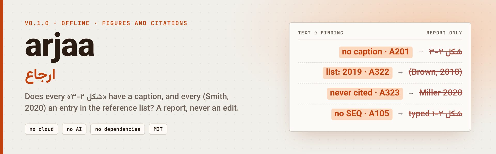

<div align="center">

<picture>
  <source media="(prefers-color-scheme: dark)" srcset="assets/banner-dark.png">
  
</picture>

**English** · [فارسی](README.fa.md) · [🌐 Live site](https://mrzroot.github.io/arjaa/) · [📦 Release v0.1.0](https://github.com/mrzroot/arjaa/releases/tag/v0.1.0) · [🗒 Changelog](CHANGELOG.md)

     

</div>

> **arjaa** (ارجاع, "reference") reads a Persian `.docx` and checks that every ⁧«شکل ۲-۳»⁩ has a caption and every `(Smith, 2020)` has an entry in the reference list, with Jalali and Gregorian years handled. Offline; it **reports, it never edits** your file.

**Contents:** [Why](#-why) · [Install](#-install) · [Quick start](#-quick-start) · [Before / after](#-before--after) · [Features](#-features) · [Rules](#-rules-and-finding-codes) · [How it works](#-how-it-works) · [Limits & honesty](#-limits--honesty) · [Roadmap](#-roadmap) · [Contributing](#-contributing) · [License](#-license)

## 🎯 Why

A thesis is edited for a year. A figure is deleted and the later ones are renumbered by hand, a paragraph is pasted from another chapter, a source is added to the text and not to the list, a list entry outlives the sentence
that cited it. Word's cross-reference fields and a reference manager prevent all of this, *if they were used from the first page*; in practice many theses have typed numbers and typed citations. The errors are invisible
until the examiner finds `شکل ۲-۳` pointing at nothing. The tools I found for this check English-language manuscripts (see [NOVELTY.md](NOVELTY.md)); none of the ones I read about mentions that a chapter is called `فصل دوم`, that the caption
number may be written `۲-۳`, `2-3` or `٢-٣`, or that a Persian entry is dated in the Jalali calendar and a Latin one is not.

## 📦 Install

Python 3.9+, no dependencies. Tested on Linux only.

```sh
pipx install git+https://github.com/mrzroot/arjaa      # PyPI release not published yet
uvx --from git+https://github.com/mrzroot/arjaa arjaa --demo
pip install -e .                                      # from a clone
```

## 🚀 Quick start

```sh
arjaa thesis.docx                       # check
arjaa thesis.docx --map                 # also: every caption → where mentioned; every reference entry → times cited
arjaa thesis.docx --json                # machine-readable
arjaa thesis.docx --strict              # exit 1 on warnings too (default: only on errors); for scripts
arjaa thesis.docx --skip A105,A204      # leave codes or prefixes out (A3 = all citation checks)
arjaa thesis.docx --current-year 2026   # for the «year in the future» check (default: today)
arjaa --demo                            # generate a synthetic thesis with planted problems and check it
arjaa --make-sample thesis.docx [--clean]   # just write that sample (the clean one has zero findings)
arjaa notes.md                          # .txt/.md work too (headings: # or the words «فصل …», «منابع»)
```

Exit codes: 0 nothing (or only warnings without `--strict`), 1 findings, 2 cannot read the file.

Real output on a synthetic document (excerpt):

```text
$ arjaa thesis.docx                # a synthetic thesis generated by `arjaa --demo`; excerpt
arjaa 0.1.0 · thesis.docx · 55 paragraphs
floats: 5 «شکل», 2 «جدول» · 6 mention(s), 0 Word cross-reference field(s) · 3 chapters
references: 9 entries (author-year) · 9 citation(s) recognised in the text

✗ A101 the same caption number is used twice   [¶34]
      ¶34  ⁦شکل ۳-۱: ساختار شبکه⸱ی حسگر⁩   — same number as ¶32
    why : Two figures (or tables) with one number make every in-text reference ambiguous.
    fix : Renumber one of them; if the captions use Word's SEQ field, press Ctrl+A, F9.

✗ A201 mention of a figure/table that has no caption   [¶15]
      ¶15  ⁦مقایسه⸱ی دو روش در شکل ⟦۲-۳⟧ و نمودار ۲-۱ نشان داده⁩   — captions: ۲-۱, ۲-۲, ۲-۴, ۳-۱
    why : The text points at a number that does not exist in this document (typo, deleted figure, or a number from another chapter).
    fix : Correct the mention or add the missing caption.

✗ A322 citation year differs from the reference entry   [2× ¶6  ¶11]
       ¶6  ⁦Brown, 2031⁩   — list has Brown with 2018
      ¶11  ⁦احمدی، ۱۴۰۱⁩   — list has احمدی with ۱۴۰۰
    why : The list has this author, but with another year: usually a typo, or one of two works by the same author.
    fix : Make the year in the text and in the list agree.

[…]

4 error(s), 8 warning(s), 4 note(s).
```

(Persian lines are wrapped in invisible isolate marks so they print the same in any terminal; `⸱` marks a half-space (ZWNJ) and `⟦ ⟧` the characters the finding is about. The full, unedited output is in [docs/demo.txt](docs/demo.txt).)

`--map` adds the whole picture, which is what you want when you are renumbering by hand ([docs/demo-map.txt](docs/demo-map.txt)):

```text
$ arjaa thesis.docx --map          # excerpt
map: every caption, where it is, and where the text mentions it
  ⁦شکل ۲-۱⁩          ¶10   SEQ    mentioned ¶8
  ⁦شکل ۲-۲⁩          ¶13   SEQ    mentioned never
  ⁦شکل ۲-۴⁩          ¶17   typed   mentioned never
  ⁦جدول ۲-۱⁩         ¶19   SEQ    mentioned ¶18
  ⁦شکل ۳-۱⁩          ¶32   SEQ    mentioned ¶30
  ⁦شکل ۳-۱⁩          ¶34   typed   mentioned ¶30
  ⁦جدول ۲-۲⁩         ¶36   typed   mentioned ¶35
  …
references: entry → times cited
  ¶48   ⁦Brown, T.⁩                                          2018   cited 2×
  ¶49   ⁦Brown, T.⁩                                          2018   cited 2×
  ¶50   ⁦Miller, A.⁩                                         1399   cited 0×
  ¶51   ⁦Wang, L.⁩                                           2019   cited 0×
```

## 🆚 Before / after

An invented mini thesis (`a.md`) and what `arjaa a.md` reports (real output, abridged):

```text
# فصل دوم
همان‌طور که در شکل ۲-۱ دیده می‌شود، نتایج بهبود یافت (Brown, 2018). شکل ۲-۳ روند را نشان می‌دهد.
شکل ۲-۱: نمودار اول
# منابع
Brown, T. (2019). A study. Journal.
Miller, A. (2020). Another study. Journal.
```

| code | finding |
|---|---|
| `A201` ✗ | mention of ⁧شکل ۲-۳⁩ that has no caption (captions: ⁧۲-۱⁩) |
| `A322` ✗ | `(Brown, 2018)`: the list has Brown with 2019 |
| `A323` ! | `Miller, A. (2020)` is never cited |
| `A105` · | captions typed by hand, no `SEQ` field (optional) |

End of the real output: `2 error(s), 1 warning(s), 2 note(s). arjaa reports; it never edits your file.` The tool never decides which side is right: the caption, the mention, the year in the text or in the list.

## 🧩 Features

| | |
|---|---|
| 🖼 **Figure and table numbers** | duplicates, gaps, a number from the wrong chapter, mentions of captions that do not exist, captions nobody mentions |
| 📚 **Citations vs reference list** | no entry, wrong year, never cited, duplicate entries; Persian and Latin sources mixed in one list |
| 📅 **Jalali and Gregorian** | `۱۳۹۸`, `1398` and `١٣٩٨` are the same year; a Latin entry dated `1399` or a Persian one dated `2019` gets a second look |
| 🗺 **`--map`** | every caption with where it is and where it is mentioned, every reference entry with how often it is cited: for renumbering by hand |
| 🛡 **Report only** | never writes to your file; a finding is a prompt to look, not proof of an error |
| 🔌 **Scripts and agents** | `--json`, `--strict`, `--skip`, exit codes, an `AGENTS.md` snippet |
| 🔒 **Offline** | no network, no AI, no telemetry, no dependencies |

## 🔎 Rules and finding codes

<details>
<summary><b>All finding codes (A-codes)</b></summary>

| code | severity | meaning |
|---|---|---|
| A001 | info | chapter headings not recognised (chapter-prefix checks skipped) |
| A101 | error | the same caption number used twice (`شکل ۳-۱` twice) |
| A102 | warn | caption numbers skip, go backwards, or do not start at 1 |
| A103 | warn | caption number's chapter part differs from the chapter it sits in (`جدول ۲-۲` inside chapter 3) |
| A104 | info | one kind of float numbered both `۲-۳` and `۳` |
| A105 | info | captions typed by hand (no `SEQ` field) |
| A201 | error | mention of a figure/table that has no caption (`در شکل ۲-۳` with no figure 2-3); shows the existing numbers |
| A202 | warn | caption never mentioned in the text |
| A203 | info | mentions use a label no caption uses (`نمودار ۲-۱` while captions say `شکل`) |
| A204 | info | mentions are typed, not Word cross-reference (`REF`) fields |
| A210 | warn | mention of a chapter that does not exist (`در فصل ۷` in a three-chapter thesis) |
| A301 | warn/info | no reference list found (info if the text has no citations either) |
| A311, A314 | error | numeric style: `[5]` cited but no entry 5; entry numbers are not 1…n |
| A312, A313 | warn/info | numeric style: entry never cited; numbers not in order of first appearance |
| A321 | error | author-year: citation without a matching entry |
| A322 | error | author-year: the entry has this author but another year |
| A323 | warn | author-year: entry never cited |
| A331 | warn | Latin-script entry with a Jalali-range year (`Miller, A. (1399)`) |
| A332 | warn | citation or entry dated later than this year (Gregorian) or the Jalali year |
| A333 | info | Persian-script entry with a Gregorian year |
| A334 | info | `و همکاران` after a Latin name or `et al.` after a Persian one |
| A341 | warn | duplicate or near-duplicate reference entries |

</details>

## 🔧 How it works

1. **Chapters** are Heading 1 paragraphs like `فصل دوم`, `فصل ۲` or auto-numbered headings; a **caption** starts with a label word (`شکل`, `جدول`, `Figure`, …) and a number and has the Caption style, a `SEQ` field or a separator; a **mention** is a label plus a number, list or range.
2. The **reference list** starts at a heading such as `منابع` / `References`; **citations** are `(Name, 2020)` groups and narrative `Name (2020)`; a citation matches an entry when its name tokens are among the first author's.
3. Digits and years are normalised across Persian, Latin and Arabic-Indic forms, so `۱۳۹۸`, `1398` and `١٣٩٨` are one year. Everything is found by pattern, so expect some false positives and misses.

How things are recognised, in one paragraph: **chapters** are Heading 1 paragraphs like `فصل دوم`, `فصل ۲`, `۲ مقدمه` or auto-numbered Heading 1 (an appendix heading restarts the count). A **caption** is a paragraph that starts with a label word
(`شکل`, `جدول`, `نمودار`, `Figure`, `Table`, …) and a number and either has Word's Caption style, a `SEQ` field, or a separator after the number (`:`, a spaced dash, `. `); lines of a hand-made list of figures (dot leaders, a trailing page number) are skipped.
A **mention** is a label followed by a number, a list (`شکل ۲-۱ و ۲-۲`) or a range (`۲-۱ تا ۲-۴`). The **reference list** starts at a heading such as `منابع`, `فهرست منابع`, `مراجع`, `References` and ends at the next
Heading 1 such as `پیوست`, `Abstract`. **Citations** are `(Name, 2020)` and `(نام، ۱۳۹۸؛ Other, 2019)` groups, and narrative `Name (2020)` only when `Name` is a capitalised Latin word or a first author in the list. A citation matches an entry when its name tokens
are among the entry's first-author tokens.

## 🧭 Limits & honesty

- **A cross-check, not a citation manager and not an author.** It never edits your file, and a finding is not proof of an error. Your university's guide decides what is required; the thesis stays yours.

- **Heuristics, not an official validator.** Everything is found by pattern. Expect some false positives (a mention like «جدول ۱» that refers to *another* work looks like a dangling mention if the thesis has its own tables) and some misses
  (a citation written in an unusual way is not seen at all). `--skip` and `--map` exist so you can check by eye. Your university's guide decides what is required; arjaa does not know it.
- **Reports only.** It never edits the file, and a finding is not proof of an error: `(Johnson, 2017)` may be a source you left out on purpose.
- **I have not opened any output in Microsoft Word.** Fixtures were generated and rendered in LibreOffice 25.2 on Linux; the Word behaviour of `SEQ` and `REF` fields is reasoned from the OOXML, not observed.
- The reference list is read as **APA-like author-year** (name, then year in parentheses) or as numbered entries `[1]`; Vancouver-style or free-form lists, and lists where the year does not follow the author, are poorly understood. Persian narrative citations
  (`رضایی (۱۳۹۸)`) are accepted only when `رضایی` is a first author in the list, because a Persian word before `(۱۳۹۸)` is not provably a name; a source cited only that way and missing from the list is therefore not reported.
- Footnotes, endnotes, text boxes, headers, comments and **Zotero / EndNote / Mendeley fields** are not read (the report lists what was skipped); a bibliography generated by a field is seen only as its visible text. `.doc` must be saved as `.docx` first.
- Chapter-prefix checks need chapter headings it can recognise; without them (A001) they are skipped. Captions in text boxes are out of scope, and the caption must be in the paragraph that carries it (a figure and caption in one table cell are read, a text box is not).
- Not checked: whether the cited work exists, DOI validity, formatting of entries, spelling, sorting of the list, equations.
- Offline: no network, no AI, no telemetry. Reads the file you pass. Not tested on Windows or macOS.

## 🗺 Roadmap

- [ ] Open fixtures in real Microsoft Word to confirm how `SEQ` and `REF` fields behave
- [ ] Vancouver-style and free-form reference lists
- [ ] Footnotes, endnotes and Zotero / EndNote / Mendeley fields
- [ ] A PyPI release

## 🤝 Contributing

Standard library only, Python 3.9 must keep working, tests use invented, generated `.docx` fixtures (never a real thesis). Read [CONTRIBUTING.md](CONTRIBUTING.md); issues and pull requests use the templates. Cite: [CITATION.cff](CITATION.cff).

```sh
git clone https://github.com/mrzroot/arjaa && cd arjaa
pip install -e ".[test]" && pytest
```

**Related**

[payanlint](https://github.com/mrzroot/payanlint) lints typing and Word formatting of the same thesis, and [vazhgun](https://github.com/mrzroot/vazhgun) audits paragraph direction and the order of numbers inside `شکل ۲-۳`. Run all three.
See [NOVELTY.md](NOVELTY.md) for the research on existing tools and an honest comparison.

**For agents**

Paste [docs/AGENTS.snippet.md](docs/AGENTS.snippet.md) into `AGENTS.md` / `CLAUDE.md` / Cursor rules so an assistant checks a Persian thesis for dangling figure and citation references.

## 📄 License

MIT · [Mohammadreza Zare (mrzroot)](https://github.com/mrzroot)
